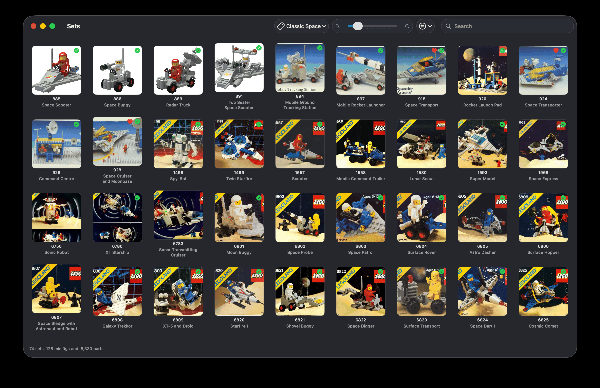
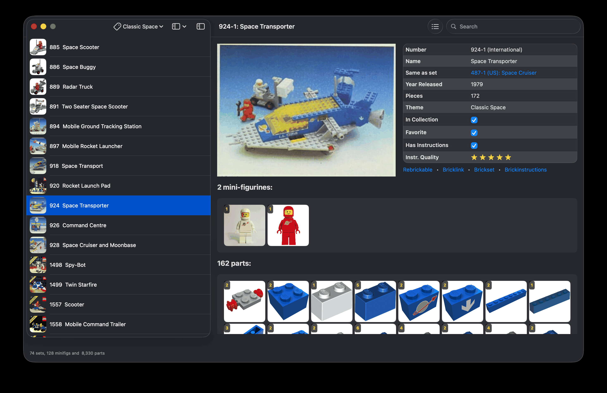
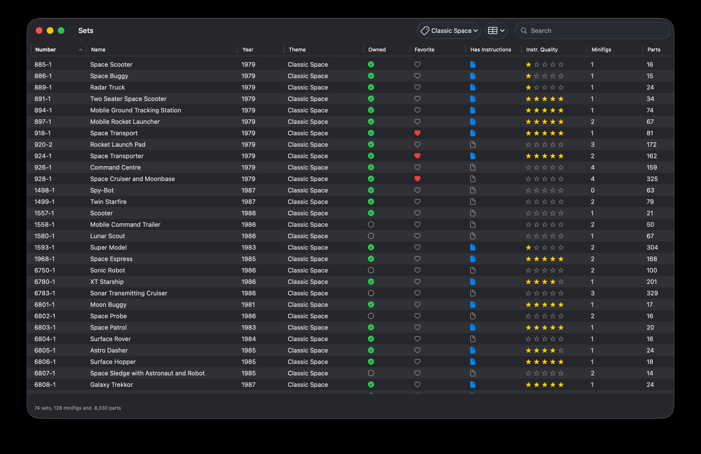

# BRIQ

A cross-platform SwiftUI application for iOS and macOS that manages personal LEGO set collections.

## Screenshots





## Features

- **Comprehensive LEGO Database**: Browse and manage LEGO sets, parts, and minifigures. It uses the publicly available data from [Rebrickable](https://rebrickable.com/downloads/) that is adapted for this application by [briq-utils](https://github.com/sperano/briq-utils).
- **Cross-Platform**: Native apps for both iOS and macOS with platform-specific features
- **User Data Management**: Track owned sets, favorites, and instruction availability
- **Database Import/Export**: Backup and restore user data (macOS)
- **Theme Organization**: Browse sets by LEGO themes with hierarchical organization

## Requirements

- **iOS**: iOS 18.6+
- **macOS**: macOS 14.6+
- **Xcode**: 16.0+ for building from source (the project file uses the Xcode 16 format)

## Installation

### Building from Source

1. Clone the repository
2. Open `BRIQ.xcodeproj` in Xcode
3. Select your target platform (BRIQ-ios or BRIQ-macos)
4. Build and run (⌘+B to build, ⌘+R to run)

### First Launch

On first launch, the app will initialize its database by loading comprehensive LEGO data from a bundled archive. This process may take a few moments and progress will be displayed.

## Architecture

### Core Data Models

- **Set**: LEGO sets with associated parts, minifigures, and themes
- **Part**: Individual LEGO parts with categories and color information
- **Minifig**: LEGO minifigures
- **SetPart/SetMinifig**: Junction models linking sets to parts/minifigs with quantities
- **SetUserData**: User preferences per set (owned status, favorites, instructions)

### Project Structure

```
BRIQ/
├── BRIQ-ios/           # iOS-specific app files and views
├── BRIQ-macos/         # macOS-specific app files and platform features
└── Shared/             # Cross-platform code
    ├── Auto-Generated/ # Theme, category, and color data generated by briq-utils
    ├── CoreData/       # Core Data models and stack
    ├── SampleData/     # Sample data providers for SwiftUI previews
    └── Views/          # SwiftUI views organized by feature
```

### Data Regeneration

`Resources/init.zip` (the bundled LEGO database) and `Shared/Auto-Generated/*.swift`
(`Themes.swift`, `PartCategories.swift`, `PartColors.swift`) are both produced by
[briq-utils](https://github.com/sperano/briq-utils) from the same Rebrickable data
snapshot. The generated Swift files reference ids (themes, categories, colors) that
must match what's packed into `init.zip`; regenerate both together from the same
briq-utils run and commit them as a pair, never one without the other.

## Platform Differences

### iOS
- Basic navigation and browsing interface
- Core set, part, and minifigure management

### macOS
- Extended menu commands for database management
- User data import/export functionality
- Multiple view modes and settings window
- Enhanced navigation and window management

## Database Management

- **Automatic Initialization**: Database is populated on first launch from bundled data
- **Corruption Recovery**: Automatic database recreation with error handling
- **User Data Preservation**: User preferences can be preserved during database resets (macOS)
- **Import/Export**: Backup and restore user data via JSON format (macOS)

## Development

The app uses modern SwiftUI patterns with Core Data for persistence. Key components include:

- `CoreDataStack`: Manages the Core Data persistent container, contexts, and store reset/recovery
- `DatabaseInitializer`: Owns first-launch import, failure recovery, and reinitialization
- `BundledData`: Handles initial data loading from ZIP archive
- `Database.swift`: User-data import/export utilities

### AI Usage

I also took the opportunity to try out and learn Claude Code and have been happy with the results.

## License

[MIT License](LICENSE)
